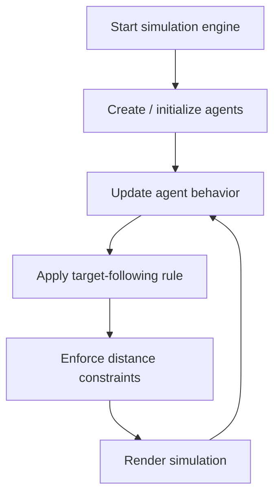

<div align="center">

# Multi-Agent System — Moving Blocks

**A Java simulation of concurrent agents following a target while respecting distance constraints.**


</div>

## Contents

- [Overview](#overview)
- [Agent rules](#agent-rules)
- [Simulation model](#simulation-model)
- [Requirements](#requirements)
- [Build and run](#build-and-run)
- [Repository structure](#repository-structure)
- [Concepts explored](#concepts-explored)
- [License](#license)

## Overview

This project is a small Java multi-agent simulation. Multiple blue block agents move in relation to an orange target while respecting minimum-distance constraints.

The project explores the relationship between agent behavior, shared simulation state, and concurrent execution using Java threads.

## Agent rules

- Blue agents follow the orange target.
- Each blue agent maintains a minimum distance from the target.
- Blue agents also maintain a minimum distance from one another.

## Simulation model



The diagram summarizes the documented behavior; synchronization and scheduling details should be inspected in the Java source.

## Requirements

- Java Development Kit (JDK)
- Terminal with `javac` and `java`

## Build and run

The included [comp.sh](comp.sh) script compiles the simulation classes and launches the engine:

```bash
chmod +x comp.sh
./comp.sh
```

Equivalent commands from the repository root are:

```bash
cd src
javac Simulation/Engine.java Simulation/Tela.java Simulation/Creatura.java
java Simulation.Engine
```

## Repository structure

```text
SistemaMultiAgentes_bloquinhos/
├── src/
│   └── Simulation/
│       ├── Engine.java
│       ├── Tela.java
│       └── Creatura.java
├── comp.sh
└── README.md
```

## Concepts explored

- Multi-agent systems
- Concurrent execution with threads
- Target-following behavior
- Spatial separation constraints
- Simulation update and rendering loops

## License

No `LICENSE` file is currently included. Unless a license is added, reuse and redistribution permissions are not granted by this repository.
